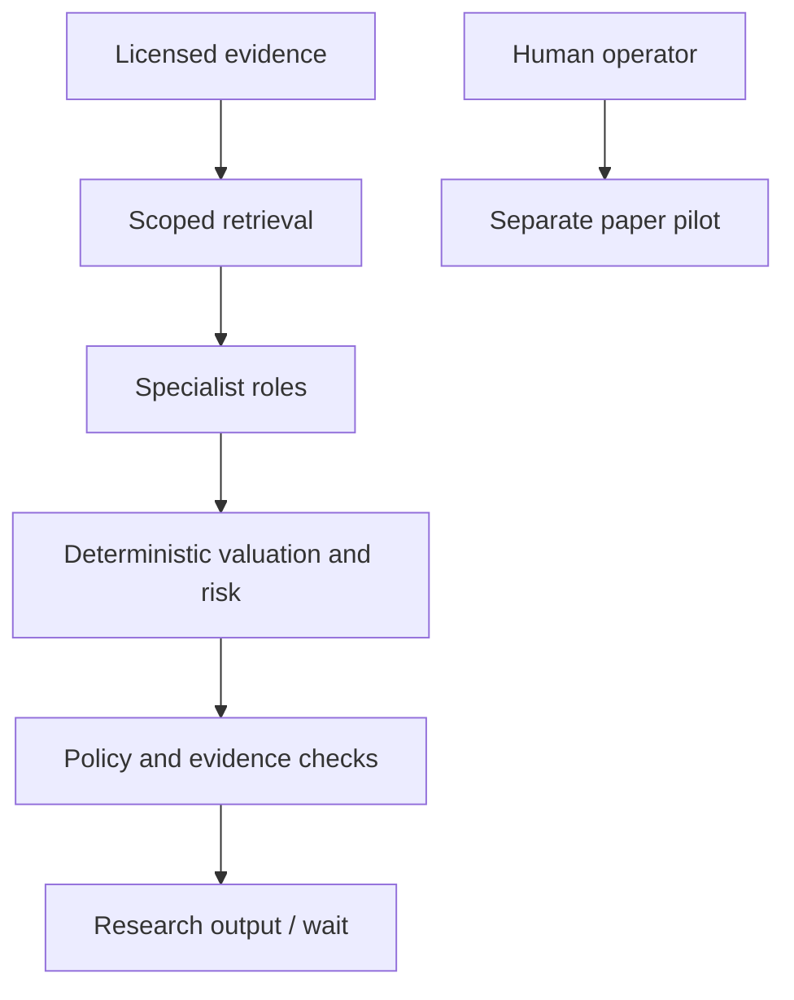

# Atlas Investment OS

**50 specialist roles. One auditable investment research workflow.**

Local-first research, valuation, quantitative analysis, risk and governance. The 50 roles are registered logical specialists, not 50 continuously running LLMs.

[Quick start](#quick-start) · [Capabilities](#what-you-can-do) · [Engineering reference](ENGINEERING.md) · [Contribute](CONTRIBUTING.md)

[](https://github.com/RyanYang053/50agent-invest-system/actions/workflows/ci.yml)


## Quick start

```bash
git clone https://github.com/RyanYang053/50agent-invest-system.git
cd 50agent-invest-system
python -m venv .venv
```

Activate with `source .venv/bin/activate` on macOS/Linux or `.venv\Scripts\Activate.ps1` in PowerShell.

```bash
python -m pip install -e '.[market_calendar,test,quant,ml]'
python scripts/demo.py --output atlas-demo.html
```

Open the generated HTML file locally. The report runs the actual offline integration smoke and displays the role manifest. No broker or paid model calls; not a live agent trace.

## What you can do

| Area | Capabilities |
| --- | --- |
| Evidence | Point-in-time SEC normalization, source licensing and scoped retrieval |
| Valuation | FCFF DCF, reverse DCF, scenarios and conditional Kelly |
| Quant | Rolling training, fixed experiments and risk challengers |
| Workflow | Role-specific tasks, event routing, reviewed skills and private memory namespaces |
| Governance | Fail-closed checks and operator approval |



## Explore the roles

```bash
atlas-core catalog --roles "config/50 agent manifest.json"
atlas-core readiness
python -m atlas_pro
python -m atlas_pro.paper_replay
```

- [Role manifest](config/50%20agent%20manifest.json)
- [Capability packs](docs/0.18.0%20Employee%20Capability%20Packs.md)
- [Architecture and operations](docs/Architecture%20and%20Operations.md)
- [Verification report](docs/Current%20Verification%20Report.md)
- [Paper pilot](docs/0.5.0%20Paper%20Pilot%20Runbook.md)
- [Macro source refresh](docs/0.20%20Macro%20Source%20Refresh.md)

Research prototype: no live order submission. Paper pilot is separate, disarmed by default and operator-only. Offline fixtures do not prove returns, independent role competence, real-provider readiness or professional certification.

## Verification

```bash
python -m pytest -q
```

See [engineering reference](ENGINEERING.md) for the preserved previous technical documentation, [launch gates](docs/LAUNCH.md) and [license status](LICENSING.md).

## Related projects

- [IBKR Agent Harness](https://github.com/RyanYang053/IBKR-Agent-harness) — Local-first Python and MCP toolkit for Interactive Brokers portfolio research, combining deterministic calculations, investment policy checks, valuation and persistent workflows with human approval..
- [IBKR Portfolio Analyzer](https://github.com/RyanYang053/ibkr-portfolio-analyzer) — Local-first desktop analytics for holdings, performance, risk and research.

These are separate projects, not a claimed integrated deployment.

## Contributing

See [CONTRIBUTING.md](CONTRIBUTING.md) and [SECURITY.md](SECURITY.md). If the project is useful, consider starring it or reporting a reproducible improvement.

Research and educational use only; not financial or tax advice.
