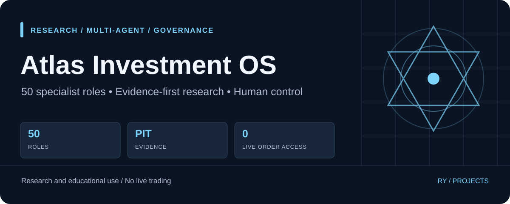

<p align="center"></p>

# Atlas Investment OS

[English](README.md) · [简体中文](README.zh-CN.md)

50 个专业投资研究角色、可追溯的证据、确定性金融计算与人工控制。

[快速开始](#快速开始) · [项目演示](#项目演示) · [50 角色目录](docs/ROLE_CATALOG.md) · [路线图](ROADMAP.md) · [参与贡献](CONTRIBUTING.md)

## 项目演示

无需真实券商账户或模型 API Key。打开 [GitHub Actions 演示工作流](https://github.com/RyanYang053/50agent-invest-system/actions/workflows/public-demo.yml)，选择成功的运行，下载 HTML 预览文件；也可按以下命令在本地生成。演示采用合成数据，并非实际收益或完整部署证明。

## 快速开始

```bash
git clone https://github.com/RyanYang053/50agent-invest-system.git
cd 50agent-invest-system
python -m venv .venv
```

macOS/Linux 使用 `source .venv/bin/activate` 激活环境，Windows PowerShell 使用 `.\.venv\Scripts\Activate.ps1`。

```bash
python -m pip install -e '.[market_calendar,test,quant,ml]'
python scripts/demo.py --output atlas-demo.html
```

使用浏览器打开生成的文件。

## 技术文档与限制

[架构与运营](docs/Architecture%20and%20Operations.md) · [验证报告](docs/Current%20Verification%20Report.md)

50 个注册逻辑角色不等于 50 个同时运行的 LLM。研究、风险与估值结果不能证明投资回报；不支持实盘下单。

[常见问题](FAQ.md) · [更新日志](CHANGELOG.md) · [安全说明](SECURITY.md) · [许可状态](LICENSING.md)。

## 相关项目

- [IBKR Agent Harness](https://github.com/RyanYang053/IBKR-Agent-harness)
- [IBKR Portfolio Analyzer](https://github.com/RyanYang053/ibkr-portfolio-analyzer)

这些仓库独立维护，并非已经完成端到端技术集成。仅供研究和教育用途，不构成金融建议。
